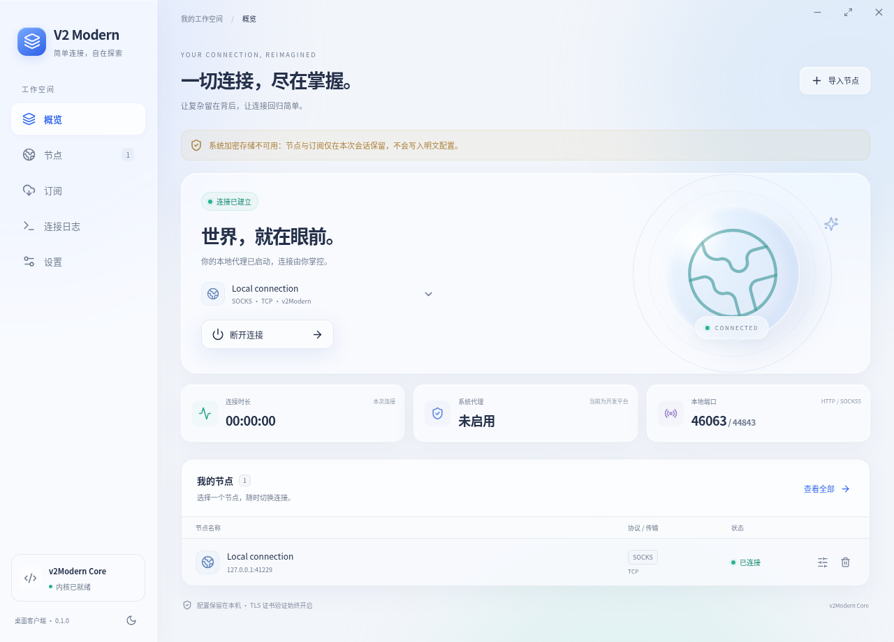
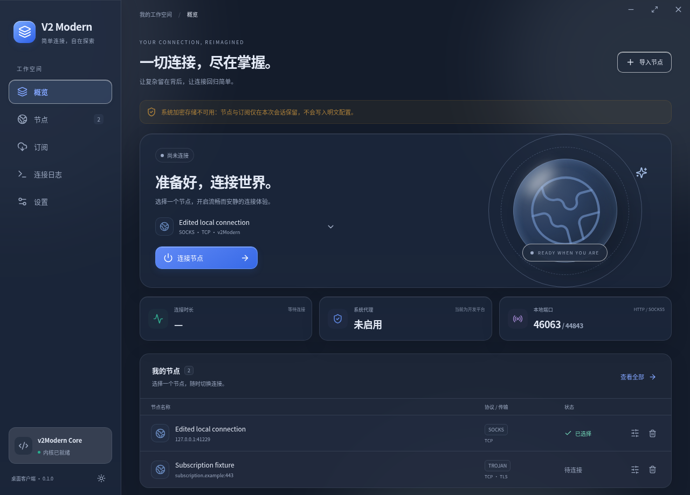

# V2 Modern 桌面客户端

面向 **Windows 10 / Windows 11 x64** 的中文代理客户端。默认调用本仓库的 V2Ray 4.31 fork，支持选择外部 Xray。界面参考 Apple Liquid Glass 的层次、玻璃导航和可读性原则，以 Electron + React + TypeScript 实现。




截图来自 Linux 上的真实本地代理测试；订阅更新使用测试数据，Windows 桌面材质须在 Windows 实机观察。

## 获取与使用

在仓库 **Actions → Desktop client** 中打开成功的构建，下载 `V2Modern-Windows-x64-<commit>` 产物。包含安装版 `V2 Modern Setup 0.1.0.exe`、便携版 `V2 Modern 0.1.0.exe` 和 `SHA256SUMS.txt`。安装版可选择安装目录；便携版直接运行。两个版本均未签名。

1. 导入节点链接，或在“订阅”中添加 HTTPS 地址并点击“更新”。也可以手动添加节点。
2. 选择节点，点击“连接”。默认开启 Windows 系统代理，仅监听本机 `127.0.0.1`。
3. Reality、Vision 或 gRPC 节点需要在“设置”中切换为 Xray，并选择可信来源的 `xray.exe`。
4. 断开连接会恢复先前的 Windows 代理设置。关闭窗口会保留连接并隐藏到托盘；右键托盘选择“退出并恢复系统代理”才能退出。

连接状态表示内核已启动、本地代理已就绪，不表示远程节点已经通过互联网可达性测试。没有伪造流量、延迟或节点在线率。

## 首版功能

- 节点链接导入与手动编辑；VMess、VLESS、Trojan、Shadowsocks、SOCKS5、HTTP。
- 明文节点列表或 Base64 编码订阅内容；HTTPS 订阅下载、原子替换与失败保留。
- TCP、WebSocket；外部 Xray 支持 gRPC、VLESS Reality 和 `xtls-rprx-vision`。
- 连接切换、端口冲突提示、内核配置校验、日志、托盘与单实例。
- Windows 用户系统代理设置、断开恢复、异常退出后的恢复记录。
- Windows Job Object 及父进程监视，阻止客户端崩溃后代理内核继续运行。
- Windows DPAPI 加密持久化；系统加密不可用时仅保留会话数据。
- 深浅色、跟随系统、减少透明、减少动态。Windows 11 22H2 及以上启用原生 Acrylic 背景，Windows 10 与较早 Windows 11 使用界面内玻璃效果。

导入遇到未知协议或参数时会明确拒绝整批数据，不会悄悄遗漏节点。首版 Shadowsocks 仅支持 `aes-128-gcm`、`aes-256-gcm`、`chacha20-ietf-poly1305`，不支持插件；VMess 支持 `auto`、`aes-128-gcm`、`chacha20-poly1305`、`none`。旧 XTLS、TCP 伪装、KCP、QUIC、XHTTP、Hysteria 等不在首版范围。订阅重定向会被拒绝，请填入最终 HTTPS 地址。

不包含 TUN、PAC、自启、测速、二维码、内核自动下载/更新或对齐全部 v2rayN 功能。仅影响使用 Windows 用户代理的应用；忽略系统代理的程序需要手动配置 HTTP / SOCKS5 端口。

## 本地开发与打包

需要 Node.js 22.12+（推荐 24）、npm、**Go 1.15.15**。旧 QUIC 依赖要求兼容的 Go 工具链；不要直接用最新 Go 替代。已存在的仓库 checkout 即可，不需要创建 Git worktree。

在 Windows PowerShell 中：

```powershell
cd desktop
npm ci
npm run typecheck
npm test
npm run build:core
npm run dev
npm run dist:win
```

`build:core` 从本仓库编译 `v2ray.exe`、`v2ctl.exe` 和进程守护 `jobhost.exe`，复制已有 GeoIP/GeoSite 数据，不会下载替代核心或修改 Go 依赖。构建输出在忽略的 `resources/core/`、`dist/`、`release/`。

若正确的 Go 可执行文件不在 PATH，可设置 `V2MODERN_GO` 为其绝对路径。Linux 上也能交叉编译 Windows 内核和便携版。安装版需要 Windows，或完整可用的 Wine；当前云环境的 Wine 11 beta 工具包缺少关键 DLL，安装版由 Windows Actions 构建。

Linux 桌面开发还需先编译本机内核：

```bash
cd /path/to/v2Modern
mkdir -p desktop/resources/core
go build -mod=readonly -o desktop/resources/core/v2ray ./main
go build -mod=readonly -tags confonly -o desktop/resources/core/v2ctl ./infra/control/main
cd desktop
npm ci
npm run dev
```

Linux 仅用于开发验证；连接前须关闭“设置 Windows 系统代理”。

## 验证与 Actions

`Desktop client` workflow 在 push、pull request 和手动触发时运行：

- Windows：类型检查、单元测试、真实注册表代理恢复、真实 fork HTTP/CONNECT 测试、父进程退出清理、Electron/DPAPI 持久化测试，构建未签名安装版与便携版，并上传 SHA-256 清单。
- Linux：类型检查、单元测试、真实 fork、生产界面与后端测试、Xvfb 中的真实 Electron 启动；下载并校验固定版本 Xray 26.3.27，验证 Reality/Vision、gRPC 配置及 HTTPS 代理；上传界面截图。

手动运行功能测试时指定对应内核绝对路径：

```powershell
$env:V2MODERN_TEST_CORE = (Resolve-Path resources/core/v2ray.exe).Path
npm run test:integration
npm run test:electron
```

Linux UI 测试需要 Chromium，`V2MODERN_TEST_CHROMIUM` 默认 `/usr/bin/chromium`。Xray 测试需要 `V2MODERN_TEST_XRAY`，并依赖 OpenSSL 生成一次性的本地 HTTPS 证书。Linux Electron 测试需要显示服务，可用 `xvfb-run -a npm run test:electron`。

远程 Reality 节点连通性、Windows 10/11 实机的材质、托盘及用户应用代理兼容性仍需使用真实节点观察；配置解析通过不代表远程服务器可连接。

## 数据与架构

- `src/shared/model.ts`：节点、订阅、设置与 IPC 输入校验。
- `src/main/`：节点解析、配置生成、内核生命周期、代理恢复、订阅与加密存储。
- `src/main/preload.ts`：有限的 IPC API。渲染进程开启 sandbox/context isolation，不提供 Node.js 或任意命令执行。
- `src/renderer/`：中文 Liquid Glass 风格界面；状态来自主进程，没有演示数据分支。
- `native/jobhost/`：Windows 内核进程守护。
- `tests/`：协议与状态测试、真实内核、真实 Electron、界面及 Windows 代理恢复测试。

Windows 配置通常位于 `%APPDATA%/V2 Modern/`。`profiles.enc` 使用 Electron safeStorage/DPAPI 加密，绑定当前用户；`proxy-recovery.json` 只存放先前代理设置。运行中的内核需要临时明文 `runtime/active-config.json`，位于当前用户的数据目录，断开时删除，重启时清理。日志只保留最近 300 条在内存中，并隐藏已知凭据；仍可能包含目标地址，分享前请检查。

其他程序修改代理服务器或启用状态后，恢复操作会保留该程序的设置；仅改变绕过列表时，保留新列表并恢复本客户端占用的服务器设置。

## 设计参考

- [Apple Human Interface Guidelines](https://developer.apple.com/design/human-interface-guidelines)
- [Apple Liquid Glass](https://developer.apple.com/documentation/technologyoverviews/liquid-glass)
- [v2rayN](https://github.com/2dust/v2rayN)：功能和工作流程参考。

Windows 没有 Apple 的原生 Liquid Glass API，本客户端以 Acrylic、CSS 背景模糊、边缘高光、克制的阴影和分层导航实现对应视觉原则。图标使用 Lucide，未复制 v2rayN 代码、Apple 字体或系统图标资源。
